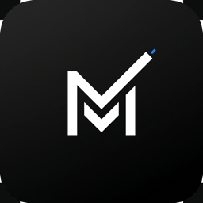
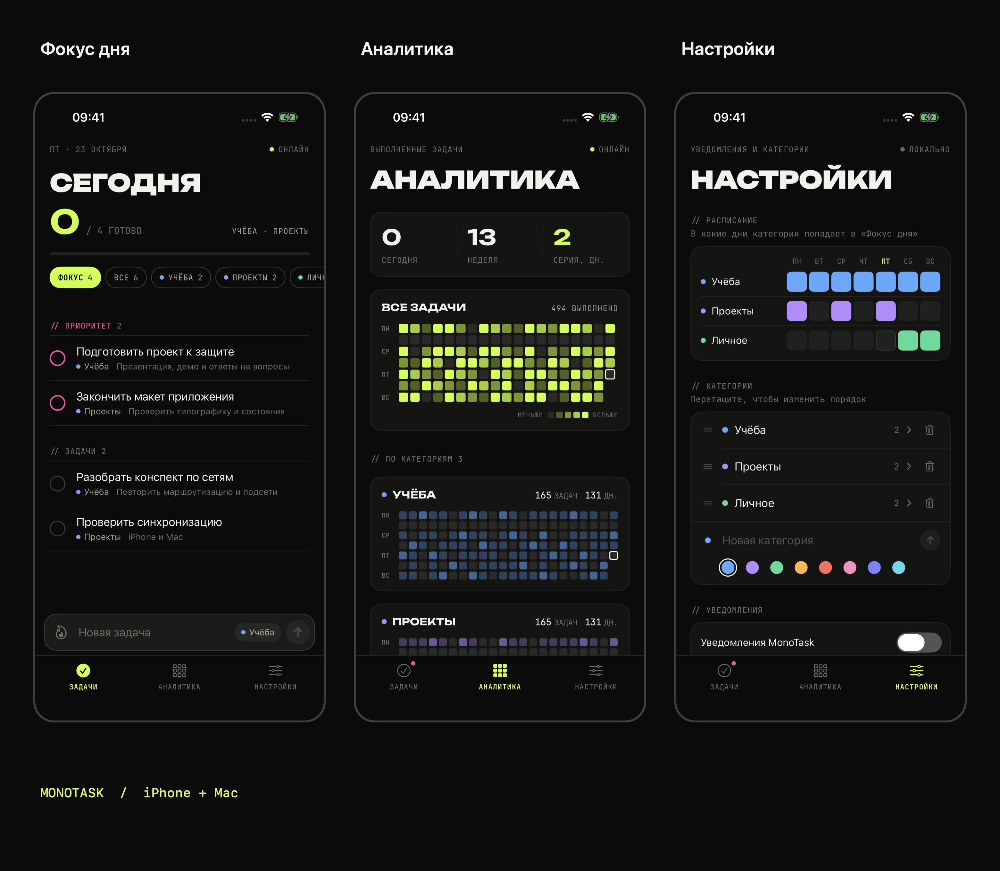

<div align="center">



# MonoTask

### Главное — в фокусе.

Личный менеджер задач для iPhone и Mac.
Категории, фокус дня и история прогресса — в одном приложении.


[Экраны](#экраны) · [Возможности](#возможности) · [Запуск](#сборка) · [Архитектура](docs/ARCHITECTURE.md)

</div>

---

## Экраны

[](docs/screenshots/overview.jpg)

Скриншоты из симулятора iPhone с демонстрационными данными. Нажмите на изображение, чтобы открыть в полном размере.

## Возможности

| | Что умеет MonoTask |
| :--- | :--- |
| **Фокус дня** | Категории появляются в фокусе по расписанию. В любой момент можно открыть общий список. |
| **Задачи** | Заметки, подзадачи, высокий приоритет и перестановка в списке. |
| **Быстрый ввод** | Новая задача добавляется из строки внизу экрана. На Mac — также через `⌘N`. |
| **Удаление с отменой** | Свайп по задаче и пять секунд, чтобы вернуть её обратно. |
| **Прогресс** | История выполнения и календарь активности, общий и по категориям. |
| **Напоминания** | Уведомления задач и утренний план на выбранные дни. |
| **Синхронизация** | SwiftData на устройстве, Supabase между устройствами. Можно работать без сети. |

На iPhone — нижние вкладки, на Mac — боковое меню. `⌘R` запускает синхронизацию. У каждого аккаунта отдельное локальное хранилище.

---

## Сборка

Требуются macOS, Xcode 16 или новее и подключение к сети для первоначальной загрузки зависимостей. Поддерживаются iOS 18+ и macOS 15+.

1. Откройте `MonoTask.xcodeproj` и дождитесь загрузки Swift Package Manager.
2. Выберите схему `MonoTask` и нужное устройство или симулятор.
3. Для физического устройства укажите свою Team в Signing & Capabilities. При необходимости замените Bundle Identifier на уникальный.
4. Запустите приложение и войдите в аккаунт или зарегистрируйтесь.

Проект можно пересоздать из `project.yml` с помощью XcodeGen:

```sh
xcodegen generate
```

## Supabase

В `MonoTask/Resources/SupabaseConfig.plist` находятся публичные клиентские параметры. Они не дают административного доступа: записи защищены авторизацией и RLS.

Для собственного сервера:

1. Выполните `docs/supabase_schema.sql` в SQL Editor своего проекта Supabase.
2. Разрешите Data API доступ к восьми таблицам `monotask_*`.
3. Добавьте `com.monotask.ios://auth-callback` в разрешённые Redirect URLs.
4. Включите Email в Authentication. Для подтверждения адресов и восстановления паролей настройте SMTP.
5. Укажите URL проекта и публичный ключ в `SupabaseConfig.plist`.

Для локальной разработки параметры можно переопределить переменными окружения `SUPABASE_URL` и `SUPABASE_ANON_KEY`. Поддерживается файл `.env` по образцу `.env.example`. Локальные настройки исключены из Git. Ключ `service_role`, пароль базы и приватные ключи в клиентское приложение не добавляются.

## Структура

- `Models` — модели SwiftData и фильтры задач.
- `Views` — экраны iPhone и Mac, формы и общие компоненты.
- `Services` — авторизация, синхронизация, уведомления и состояние сети.
- `Extensions` — операции с данными, датами, цветами и обратной связью.
- `PreviewContent` — тестовые данные для Debug-сборки симулятора.
- `Resources` — шрифты, изображения и настройки приложения.

Подробности хранения и синхронизации: [архитектура](docs/ARCHITECTURE.md). Команды проверок: [tests/README.md](tests/README.md).

## Шрифты

В приложении используются Unbounded и JetBrains Mono. Оба распространяются по SIL Open Font License; тексты лицензий находятся в `MonoTask/Resources/Fonts`.
