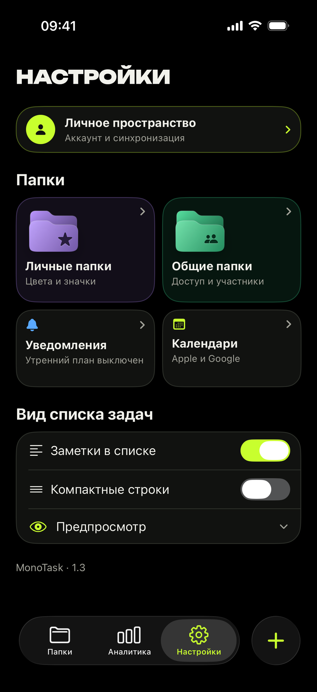

<div align="center">


# MonoTask Classic

Личные и общие папки, быстрый ввод задач и история выполнения.

[](https://github.com/egoar777/MonoTask/tree/v1.3)


[Экраны](#экраны) · [Возможности](#возможности) · [Сборка](#сборка) · [Изменения](CHANGELOG.md)

</div>

## Экраны

Скриншоты MonoTask Classic 1.3 с демонстрационными данными. Нажмите на изображение, чтобы открыть его в полном размере.

### iPhone

<table>
  <tr>
    <th>Папки</th>
    <th>Прогресс за месяц</th>
    <th>Настройки</th>
  </tr>
  <tr>
    <td><a href="docs/screenshots/ios-today.png"></a></td>
    <td><a href="docs/screenshots/ios-analytics.png"></a></td>
    <td><a href="docs/screenshots/ios-settings.png"></a></td>
  </tr>
</table>

### Mac

[](docs/screenshots/mac-today.jpg)

<table>
  <tr>
    <th>Прогресс за месяц</th>
    <th>Настройки</th>
  </tr>
  <tr>
    <td><a href="docs/screenshots/mac-activity.jpg"></a></td>
    <td><a href="docs/screenshots/mac-settings.jpg"></a></td>
  </tr>
</table>

## Возможности

| | Что умеет MonoTask |
| :--- | :--- |
| **Совместная работа** | Общие папки, участники, ответственные и приглашения по ссылке или QR-коду. Правки без сети сохраняются в очередь. [Совместная работа](docs/SHARED-LISTS.md). |
| **Папки** | Личные папки с цветами и значками. В папке «Все задачи» видны задачи из всех личных папок. |
| **Задачи** | Заметки, подзадачи, три уровня приоритета и перестановка в списке. |
| **Быстрый ввод** | На iPhone «+» раскрывает строку, нажатие на поле открывает клавиатуру. На Mac кнопку «+» дополняет `⌘N`, которое сразу переводит фокус на поле ввода. |
| **Удаление с отменой** | Свайп по задаче и пять секунд, чтобы вернуть её обратно. |
| **Прогресс** | История выполнения и календарь активности, общий и по категориям. |
| **Напоминания** | Уведомления задач, утренний план на выбранные дни и подключение календарей. |
| **Синхронизация** | SwiftData на устройстве, Supabase между устройствами. Можно работать без сети. |

На iPhone и Mac используется одна сетка папок и нижняя навигация. Панель использует Liquid Glass на iOS 26+ и macOS 26+, на более ранних версиях используется системный материал. На Mac `⌘R` запускает синхронизацию. У каждого аккаунта отдельное локальное хранилище.

---

## Сборка

Требуются macOS, Xcode 26 или новее и подключение к сети для первоначальной загрузки зависимостей. Поддерживаются iOS 18+ и macOS 15+.

1. Откройте `MonoTask.xcodeproj` и дождитесь загрузки Swift Package Manager.
2. Выберите схему `MonoTask` и нужное устройство или симулятор.
3. Для физического устройства укажите свою Team в Signing & Capabilities. При необходимости замените Bundle Identifier на уникальный.
4. Запустите приложение и войдите в аккаунт или зарегистрируйтесь.

Проект можно пересоздать из `project.yml` с помощью XcodeGen:

```sh
xcodegen generate
```

## Supabase

В `MonoTask/Resources/SupabaseConfig.plist` находятся публичные клиентские параметры. Они не дают административного доступа: записи защищены авторизацией и RLS.

Для собственного сервера:

1. Выполните `docs/supabase_schema.sql`, затем `docs/migrations/20261028_shared_lists.sql` в SQL Editor своего проекта Supabase.
2. Разрешите Data API доступ к восьми таблицам `monotask_*`.
3. Добавьте `com.monotask.ios://auth-callback` в разрешённые Redirect URLs.
4. Включите Email в Authentication. Для подтверждения адресов и восстановления паролей настройте SMTP.
5. Укажите URL проекта и публичный ключ в `SupabaseConfig.plist`.

Для локальной разработки параметры можно переопределить переменными окружения `SUPABASE_URL` и `SUPABASE_ANON_KEY`. Поддерживается файл `.env` по образцу `.env.example`. Локальные настройки исключены из Git. Ключ `service_role`, пароль базы и приватные ключи в клиентское приложение не добавляются.

### Вход через Apple и Google

В Supabase откройте **Authentication → URL Configuration** и добавьте `com.monotask.ios://oauth-callback` в **Redirect URLs**. В кабинетах провайдеров укажите HTTPS-адрес Supabase вида `https://<project-ref>.supabase.co/auth/v1/callback`. Для MonoTask точный адрес можно скопировать из формы провайдера.

- **Google** — создайте OAuth-клиент типа Web application в Google Auth Platform и добавьте HTTPS-адрес Supabase в Authorized redirect URIs. Укажите Client ID и Client Secret в **Authentication → Sign In / Providers → Google**. Для проверки достаточно режима Testing и стандартных разрешений входа `openid`, `email` и `profile`. [Настройка Supabase](https://supabase.com/docs/guides/auth/social-sign-in/auth-google), [режимы Google OAuth](https://developers.google.com/identity/protocols/oauth2/production-readiness/overview)
- **Apple** — включите Sign in with Apple для App ID, свяжите с ним Services ID и добавьте домен проекта и HTTPS-адрес Supabase в его настройки. Укажите Services ID и подписанный Apple client secret в **Authentication → Sign In / Providers → Apple**. Для веб-входа у client secret срок действия до шести месяцев. [Документация Supabase](https://supabase.com/docs/guides/auth/social-sign-in/auth-apple)

После включения провайдера проверьте первый вход, перезапуск с сохранённой сессией, выход и повторный вход тем же аккаунтом. Проверьте, что после повторного входа открываются задачи этого аккаунта.

## Структура

- `Models` — модели SwiftData и фильтры задач.
- `Views` — экраны iPhone и Mac, формы и общие компоненты.
- `Services` — авторизация, синхронизация, уведомления и состояние сети.
- `Extensions` — операции с данными, датами, цветами и обратной связью.
- `PreviewContent` — тестовые данные для Debug-сборки симулятора.
- `Resources` — шрифты, изображения и настройки приложения.

Подробности хранения и синхронизации: [архитектура](docs/ARCHITECTURE.md). Команды проверок: [tests/README.md](tests/README.md).

## Шрифты

Для заголовков используется Unbounded Black, для остального интерфейса — системный шрифт. Unbounded распространяется по SIL Open Font License; текст лицензии находится в `MonoTask/Resources/Fonts`.
